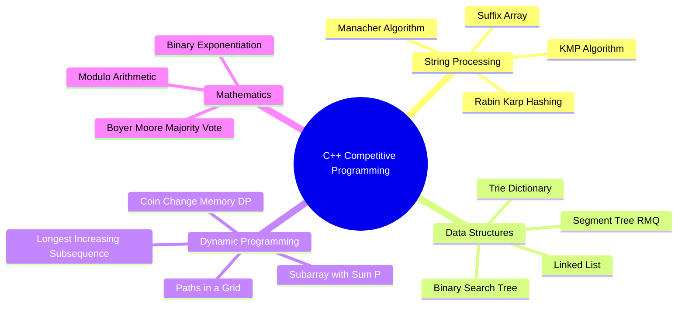

<div align="center">

# 💻 C++ ALGORITHMS & COMPETITIVE PROGRAMMING 💻
### ⚡ Advanced Data Structures & Algorithm Implementations in Modern C++
*Kho Lưu Trữ Thuật Toán Nâng Cao, Cấu Trúc Dữ Liệu Chuyên Sâu & Lời Giải Bài Tập VNOI / Codeforces*

[](https://isocpp.org/)
[](https://vnoi.info/)
[](https://codeforces.com/)
[](https://github.com/baolam/c_plus_plus_exercise)

---

</div>

> [!IMPORTANT]
> **C++ Algorithms & Competitive Programming** là thư viện tổng hợp mã nguồn tự triển khai các cấu trúc dữ liệu kinh điển, giải thuật tối ưu và lời giải các bài tập lập trình thi đấu (Competitive Programming) với độ phức tạp thời gian và không gian tối ưu nhất.

---

## 📑 Mục Lục (Table of Contents)
- [✨ Các Chuyên Đề Nổi Bật](#-các-chuyên-đề-nổi-bật)
- [🌳 Phân Loại Cấu Trúc Dữ Liệu & Giải Thuật](#-phân-loại-cấu-trúc-dữ-liệu--giải-thuật)
- [📂 Cấu Trúc Thư Mục](#-cấu-trúc-thư-mục)
- [🛠️ Hướng Dẫn Biên Dịch & Chạy](#️-hướng-dẫn-biên-dịch--chạy)
- [📜 Giấy Phép (License)](#-giấy-phép-license)

---

## ✨ Các Chuyên Đề Nổi Bật

| Chuyên Đề | Thuật Toán Triển Khai | Ứng Dụng Kinh Điển |
| :--- | :--- | :--- |
| 🔤 **Xử Lý Xâu Ký Tự (String)** | KMP, Rabin-Karp Rolling Hash, Manacher, Suffix Array | Tìm kiếm xâu mẫu trong $O(N+M)$, đếm số lượng xâu con phân biệt, tìm palindrome dài nhất $O(N)$. |
| 🌲 **Cây & Cấu Trúc Nâng Cao** | Segment Tree (RMQ/Update), Trie, Binary Search Tree (BST) | Xử lý truy vấn đoạn, cập nhật điểm/đoạn trong $O(\log N)$, tra cứu tiền tố xâu ký tự. |
| 📊 **Quy Hoạch Động (DP)** | LIS ($O(N \log N)$), Coin Change, Grid Paths, Subsets | Tối ưu hoá dãy con tăng, bài toán cái túi, bài toán đổi tiền xu, đếm số cách đi ma trận. |
| 🧮 **Số Học & Tổ Hợp** | Binary Exponentiation, Modular Arithmetic, Sieve of Eratosthenes | Tính luỹ thừa nhanh $O(\log P)$, nghịch đảo modulo, sinh tổ hợp và hoán vị. |

---

## 🌳 Phân Loại Cấu Trúc Dữ Liệu & Giải Thuật



---

## 📂 Cấu Trúc Thư Mục

```bash
c_plus_plus_exercise/
├── 📂 SEGMENT_TREE_FOR_MAXIMUM_AND_MINIMUM_QUERIES_UPDATES/ # Cây phân đoạn tổng quát
├── 📂 KMP-MYOWN/                     # Triển khai thuật toán Knuth-Morris-Pratt
├── 📂 MANACHER_ALGORITHM/            # Thuật toán tìm palindrome tuyến tính O(N)
├── 📂 SUFFIX_ARRAY/                  # Mảng hậu tố tối ưu
├── 📂 COUNT_DISTINCT_SUBSTR_RABIN_KARP/ # Đếm xâu con phân biệt bằng Rolling Hash
├── 📂 LIS_RECURSIVE_WITH_MEM/        # Dãy con tăng dài nhất quy hoạch động
├── 📂 COIN_PROBLEM_MEMORY_DP/        # Bài toán đồng xu có nhớ
├── 📂 BINARY_EXPONENTIATION/         # Luỹ thừa nhị phân O(log N)
├── 📂 TRIE_EXAMPLE/                  # Cấu trúc dữ liệu Trie tra từ điển
└── 📂 #vnoi & #codeforces/          # Tuyển tập lời giải các contest lập trình
```

---

## 🛠️ Hướng Dẫn Biên Dịch & Chạy

Sử dụng trình biên dịch GCC / Clang với chuẩn C++17 và cờ tối ưu hóa `-O3`:

```bash
# Biên dịch file bất kỳ
g++ -std=c++17 -O3 path/to/file.cpp -o solution

# Chạy với input/output từ terminal hoặc file
./solution < input.txt > output.txt
```

---

<div align="center">

## 📜 Giấy Phép (License)

Dự án được phân phối dưới giấy phép **MIT License**.

---
**Made with ❤️ by [Bảo Lâm](https://github.com/baolam)**

</div>
